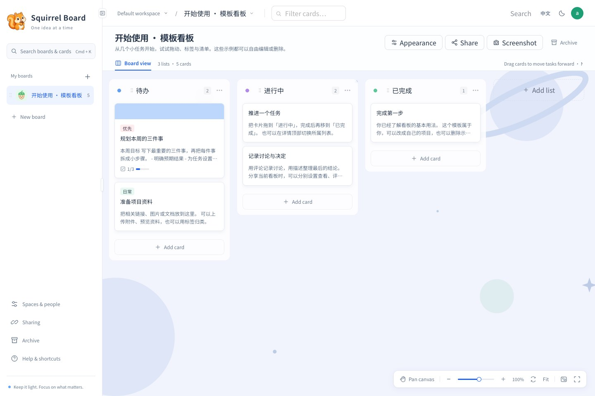
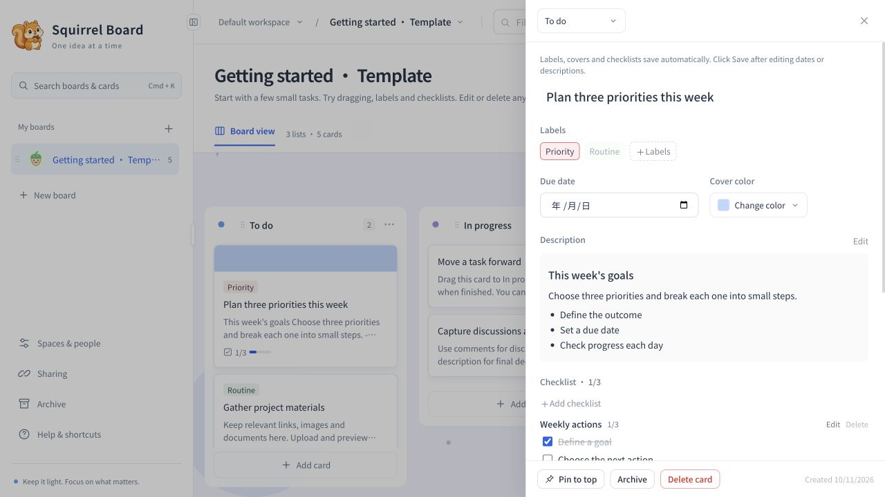
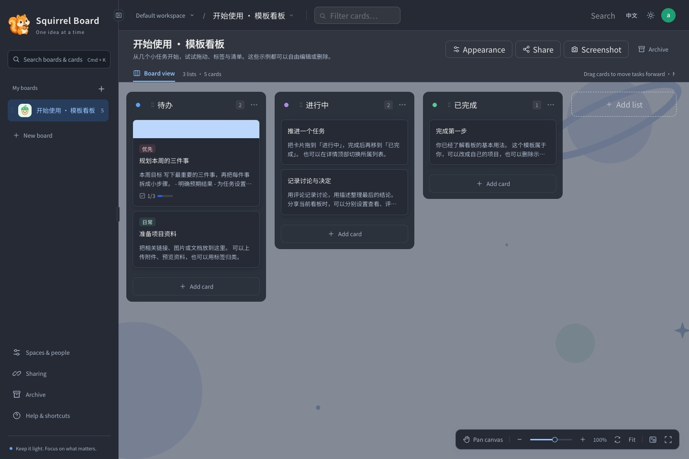

# Squirrel Kanban

[中文](README.md) · [English](README.en.md)

[GitHub — primary repository](https://github.com/zqofnewbie/squirrel-kanban) · [Gitee — mirror in China](https://gitee.com/storm07106038/squirrel-kanban)

A lightweight bilingual kanban for turning ideas into tasks and moving work forward.

Built with React + Vite, Go and SQLite. Production runs through Docker Compose with one application container and one port by default. No external database or Redis is required.



## Features

- Multiple workspaces and three account roles: super administrator, workspace administrator and member. Super administrators can transfer member management ownership.
- Drag to reorder boards, lists and cards; move cards between lists. Pin cards, add labels, due dates, covers, Markdown descriptions and checklists.
- Comments, attachment previews, downloads, archiving and restoration. Browser previews support images, PDFs, audio, video and text. Office conversion is optional.
- Independent share management with fixed short links, live content, expiration, revocation and individual collaboration switches. Guests visit one board without signing in.
- Chinese / English UI and light / dark themes. Initial preferences follow the browser; explicit choices are remembered.
- Board backgrounds, canvas pan, zoom and fullscreen, minimap, resizable / collapsible sidebar and keyboard shortcuts. Export a full-board screenshot, including off-screen lists and cards.
- Virtual rendering for large card lists, SSE updates for signed-in accounts, and foreground share checks every 15 seconds. Unchanged boards are not retransmitted.

### Card details

Manage labels, covers, descriptions and editable checklist items in the side drawer.



### Dark theme



Screenshots updated on 2026-10-15 show the current local app with the “Getting started” template board, without passwords or sharing credentials. The English screenshots use the English interface while preserving the original Chinese template content. A template is created once when the super administrator first signs in; examples can be edited or deleted.

## Local development

Requirements: **Go 1.26+, Node.js 22.12+ and npm**. Prefer a supported Go release. Use the committed `package-lock.json`; do not mix package managers.

```sh
git clone https://github.com/zqofnewbie/squirrel-kanban.git
cd squirrel-kanban
./dev.sh
```

On Windows, run `dev.bat`. Open **http://127.0.0.1:5173**. A fresh development database starts with `admin` / `admin` and prompts for a password change. These credentials are for local development only.

- Vite provides frontend hot reload; the API listens on `127.0.0.1:8090`.
- If `air` is installed, Go reloads automatically. Otherwise restart after backend changes.
- Both platforms use the same supervisor: occupied ports fail early, both HTTP services are checked for readiness, and `Ctrl+C` stops the services. If either service exits, the other is stopped too.
- Development data lives in `.dev/` and survives restarts.
- Use the same hostname consistently: `localhost` and `127.0.0.1` do not share cookies.

```sh
# macOS / Linux: custom ports or isolated test data
API_PORT=9090 WEB_PORT=5174 ./dev.sh
DEV_DATA_DIR=/tmp/squirrel-test ./dev.sh
```

Data paths can be absolute or relative to the project root, including spaces. On Windows, set the same variables before running the script:

```bat
set "API_PORT=9090"
set "WEB_PORT=5174"
set "DEV_DATA_DIR=D:\Squirrel Data"
dev.bat
```

Both services run in one terminal. Use `Ctrl+C` to stop them instead of simply closing the window. See [CONTRIBUTING.md](CONTRIBUTING.md) for checks and contribution rules.

## Docker Compose deployment

Requires Docker Engine / Docker Desktop and **Compose v2**.

```sh
cp .env.example .env
# Edit KANBAN_ADMIN_USER and KANBAN_ADMIN_PASS.
# Use a random initial password: 12–72 bytes, never empty.

docker compose config -q
docker compose up -d --build --wait
```

`docker compose config -q` validates configuration and environment variables without starting containers; success produces no output. `docker compose up -d --build --wait` builds the image, starts the service in the background and waits for its health check to pass. Run these commands from the project root.

Set `KANBAN_PORT` in `.env` to customize the host port; an unset or empty value defaults to `8080`. For example, set `KANBAN_PORT=9090`, apply it with `docker compose up -d --wait`, then open `http://SERVER_IP:9090` and allow that port through your firewall. The container still listens on `8080`, so its health check needs no changes.

The host port binds to **0.0.0.0:8080**. Open **http://SERVER_IP:8080** (or http://127.0.0.1:8080 locally). Allow TCP 8080 from the intended sources in the server firewall and cloud security group. For public access, use an HTTPS reverse proxy and set `KANBAN_COOKIE_SECURE=true`. Keep it `false` for local HTTP. Preserve Host and overwrite client-supplied forwarding headers at the proxy.

The runtime image contains neither Node nor compilers. It runs as UID/GID `10001`, with a read-only root filesystem, dropped capabilities, a writable data volume and bounded temporary storage. `/healthz` checks the service and database connection. Fresh production initialization rejects missing or short passwords; environment changes do not reset existing accounts.

```sh
docker compose logs -f kanban
docker compose up -d --build --wait  # update without deleting data
docker compose down                # stop, retain the volume
```

SQLite, attachments and backgrounds persist in **`squirrel-kanban-data`**. Do not run `docker compose down -v` when data must be retained. Separate deployments must use different host ports and volumes; never share a SQLite data directory between instances.

The named volume is mounted at `/data` inside the container, not `./data` in the project. On standard Linux Docker installations its usual location is `/var/lib/docker/volumes/squirrel-kanban-data/_data`. Run the following after the first startup creates the volume to find the actual path; Docker Desktop stores it inside its virtual machine:

```sh
docker volume inspect squirrel-kanban-data --format '{{ .Mountpoint }}'
```

### Go dependency download timeouts

If `proxy.golang.org` times out during the build, add or update this entry in your existing `.env`:

```dotenv
KANBAN_GOPROXY=https://goproxy.cn,direct
```

Run `docker compose up -d --build --wait` again. Compose passes this value to the Go build stage as a build argument; the default remains the official proxy. You may also use your own module proxy. Keep `go.sum`, the default checksum database and `go mod verify` enabled; disabling `GOSUMDB` is unnecessary. The comma-separated `direct` fallback applies only to HTTP 404/410, not network timeouts.

### Optional Office previews

```sh
docker compose -f docker-compose.yml -f docker-compose.preview.yml up -d --build --wait
```

This starts an additional Gotenberg / LibreOffice service and uses more resources. It is disabled by default; Office files can still be downloaded without it.

### Backup and migration

Stop writes and back up the entire data directory, including SQLite sidecar files and uploaded assets. Existing `./data` bind mounts are not automatically moved into the named volume.

See [deployment, backup and restore](docs/deployment.md).

## Accounts and share permissions

| Role | Scope |
| --- | --- |
| Super administrator | All accounts and workspaces; create administrators / members and transfer member management ownership |
| Workspace administrator | Create and manage their own workspaces, use assigned spaces and manage only members assigned to them |
| Member | Operate boards, cards and shares in assigned spaces; cannot create / manage spaces or manage accounts |
| Share guest | Access only the linked board, with individual collaboration switches |

Ownership transfers immediately remove the previous administrator's management access. Existing workspace access is retained. Saving account settings revokes that account's sessions; sign in again to apply the updated settings.

Each share can independently enable **pinning, cover changes, attachment previews / downloads, comments, checklist completion, card movement, content editing and card creation**. Disabled switches grant no write access. Review the selected switches when creating or editing a share. Guests cannot delete / archive cards, upload files, manage lists / labels or access other boards and account settings.

A sharing URL is an access credential: never publish a live private link. Permission changes, revocation, expiration and deletion are enforced on subsequent requests. Shared content stays live; it is not a snapshot.

## Keyboard shortcuts

| Shortcut | Action |
| --- | --- |
| `Ctrl/Cmd + K` | Quick search |
| `Ctrl/Cmd + B` | Toggle sidebar |
| `N` / `/` | Create a card / filter the current board |
| `Esc` | Close, cancel editing or clear the filter |
| `Ctrl/Cmd + wheel` / pinch | Zoom canvas |
| Two-finger scroll / `Shift + wheel` | Pan / horizontal pan |
| `Space + drag` / middle mouse | Temporary pan |
| `H` / `M` | Pan mode / minimap |
| `+` / `-` / `0` / `Shift + F` | Zoom in / out / reset / fit width |
| `F` | Toggle canvas fullscreen (admin and shared boards); `Esc` exits |

Single-key shortcuts do not trigger while typing or composing text with an IME.

## Verification and project conventions

```sh
cd web
npm ci
npm test
npm run build
cd ../server
go test ./...
go vet ./...
```

[CONTRIBUTING.md](CONTRIBUTING.md) · [SECURITY.md](SECURITY.md) · [deployment review](docs/deployment-review.md)

Git and Docker exclude runtime data, backups, credentials, dependencies, build output and browser diagnostics. Publishable template screenshots live in `docs/screenshots/`. Ignore rules do not remove previously committed history.

GitHub is the primary repository; Gitee is a synchronized mirror for users in China. `.github/workflows/ci.yml` provides verification and container smoke tests on GitHub. Real container builds and Office preview tests still require a running Docker engine. Known development-tool vulnerabilities and release blockers are recorded in the deployment review.

## License and contribution

Please use GitHub for [issues and feature requests](https://github.com/zqofnewbie/squirrel-kanban/issues) and [pull requests](https://github.com/zqofnewbie/squirrel-kanban/pulls). Gitee is a synchronized mirror for users in China; avoid duplicate reports across platforms. Report security issues through [private vulnerability reporting](https://github.com/zqofnewbie/squirrel-kanban/security/advisories/new).

Squirrel Kanban uses the [MIT License](LICENSE), allowing commercial use,
modification and redistribution while retaining the copyright and license notice.
Dependencies and fonts retain their own licenses; see [third-party notices](THIRD_PARTY_NOTICES.md).

- [Contributing](CONTRIBUTING.md): development, tests and submission conventions.
- [Security](SECURITY.md): authentication, public deployment and reporting.
- [Deployment and recovery](docs/deployment.md): ports, volumes, upgrades and rollback.
- [Release checklist](docs/release-checklist.md): repeatable regression checks and environment limits.

The API requires changing the initial password. Changing a password revokes other
sessions. Card titles allow 250 Unicode characters and descriptions 20000, with
identical validation for signed-in users and shared editors. Shared editors are
warned before discarding unsaved changes.

## Recommended project

Try my other project, [PicOptima](https://picoptima.ai): an online image toolkit for compression, format conversion, cropping, resizing, AI background removal, annotations, collages and batch export.
