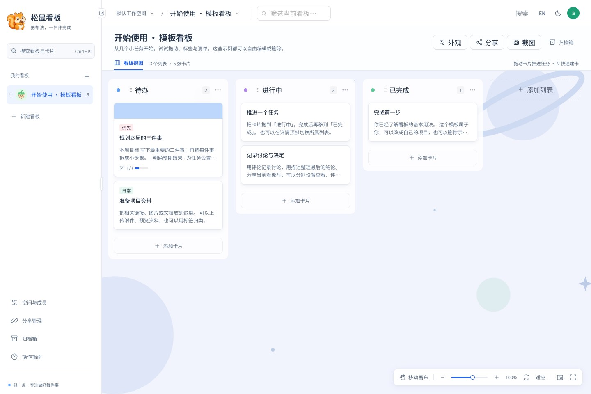
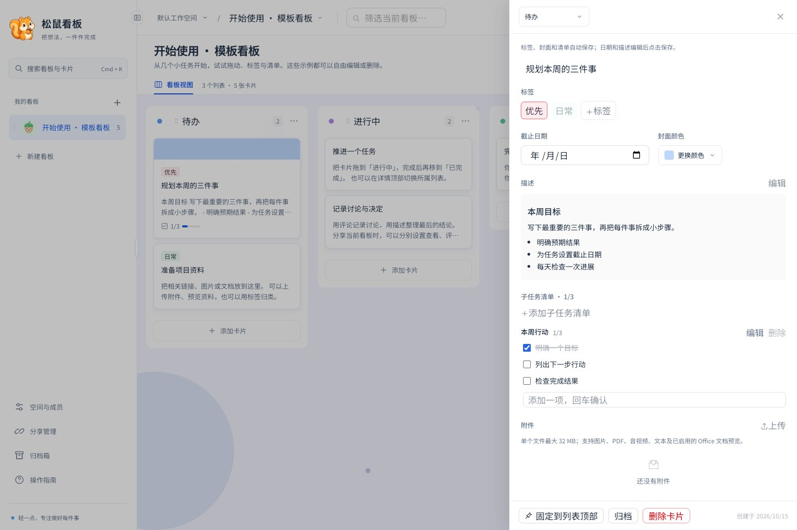
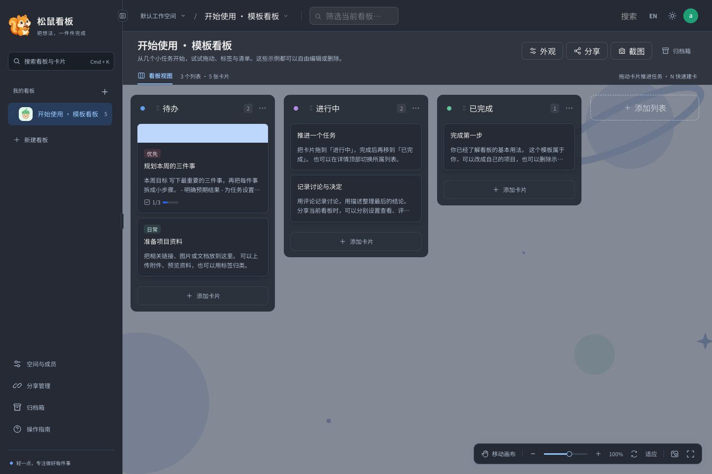

# 松鼠看板

[中文](README.md) · [English](README.en.md)

一个轻量的中英文看板，把想法变成卡片，把计划一步步完成。

React + Vite、Go、SQLite。生产环境通过 Docker Compose 部署，默认一个容器、一个端口，不需要外部数据库或 Redis。适合个人计划、小团队任务和按看板分享协作。



## 功能

- 多工作空间与三级账号：超级管理员、子管理员、成员；成员管理归属可由超级管理员调整。
- 看板、列表、卡片拖拽排序；卡片固定、标签、截止日期、封面、Markdown 描述和子任务清单。
- 评论、附件预览与下载、归档和恢复。图片、PDF、音视频和文本使用浏览器预览；Office 预览服务可选启用。
- 独立分享管理：固定短链接、实时内容、有效期、停用和独立协作权限；访客免登录访问单个看板。
- 中文 / 英文界面与浅色 / 深色主题，首次访问跟随浏览器偏好，之后保留用户选择。
- 看板背景、画布平移、缩放和全屏、缩略图、侧栏缩放与折叠、键盘快捷键；支持完整看板截图，包含视口外的列表和卡片。
- 大列表使用虚拟渲染；管理员通过 SSE 同步，分享页在前台每 15 秒检查更新，未变化时不重复传输看板。

### 卡片详情

在右侧抽屉中管理标签、封面、描述和可编辑的子任务清单。



### 深色主题



截图更新于 2026-10-15，取自本地运行的「开始使用 · 模板看板」，展示当前版本界面，不含密码或分享凭据。模板在超级管理员首次登录时创建一次，可以自由编辑或删除。

## 本地开发

需要 **Go 1.26+、Node.js 22.12+、npm**；建议使用仍受支持的 Go 版本。项目使用 `package-lock.json`，不混用包管理器。

```sh
git clone https://gitee.com/storm07106038/squirrel-kanban.git
cd squirrel-kanban
./dev.sh
```

Windows 运行 `dev.bat`。访问 **http://127.0.0.1:5173**。空开发数据库初始账号为 `admin` / `admin`，首次登录要求修改密码，仅供本机开发。

- 前端 Vite 热更新；后端默认监听 `127.0.0.1:8090`。
- 安装了 `air` 时使用 Go 热重载，否则修改后端后重启脚本。
- Mac / Linux 和 Windows 共用同一启动器：端口冲突提前报错，检查两端 HTTP 就绪，`Ctrl+C` 统一停止服务；任一服务退出会清理另一端。
- 数据保存在 `.dev/`，退出脚本不会删除数据。
- 始终使用同一主机名访问，`localhost` 和 `127.0.0.1` 的 Cookie 不通用。

```sh
# macOS / Linux：改端口或使用独立测试目录
API_PORT=9090 WEB_PORT=5174 ./dev.sh
DEV_DATA_DIR=/tmp/squirrel-test ./dev.sh
```

数据目录使用绝对路径或相对项目根目录的路径，支持空格。Windows 可在运行脚本前设置相同环境变量：

```bat
set "API_PORT=9090"
set "WEB_PORT=5174"
set "DEV_DATA_DIR=D:\Squirrel Data"
dev.bat
```

Windows 在一个终端内运行两个服务，使用 `Ctrl+C` 停止，不要只关闭窗口。手动启动见 [开发与贡献规范](CONTRIBUTING.md)。

## Docker Compose 部署

需要 Docker Engine / Docker Desktop 和 **Compose v2**。

```sh
cp .env.example .env
# 编辑 .env，设置 KANBAN_ADMIN_USER 和 KANBAN_ADMIN_PASS
# 初始密码必须是随机密码，12–72 字节，不可留空

docker compose config -q
docker compose up -d --build --wait
```

`docker compose config -q` 校验配置和环境变量，不启动容器；成功时无输出。`docker compose up -d --build --wait` 先构建镜像、后台启动服务，再等待健康检查通过。请在项目根目录执行这些命令。

主机端口通过 `.env` 中的 `KANBAN_PORT` 配置，未设置或留空时默认 `8080`。例如设置 `KANBAN_PORT=9090` 后，执行 `docker compose up -d --wait` 应用修改，通过 `http://服务器IP:9090` 访问，并放行对应端口。容器内部端口仍为 `8080`，无需修改健康检查。

默认绑定 **0.0.0.0:8080**，通过 **http://服务器IP:8080** 访问（本机可用 http://127.0.0.1:8080）。服务器防火墙和云安全组需允许所需来源访问 TCP 8080。对外部署使用 HTTPS 反向代理，并设置 `KANBAN_COOKIE_SECURE=true`；本机 HTTP 访问保持 `false`。代理保留 Host，并覆盖客户端提供的转发头。

运行镜像不包含 Node 或编译器，使用 UID/GID `10001`，根目录只读，移除 capabilities，仅数据卷和限额临时目录可写。`/healthz` 检查服务和数据库连接。首次生产初始化拒绝默认或过短密码；已有账号不会因环境变量变化被重置。

```sh
docker compose logs -f kanban
docker compose up -d --build --wait  # 更新，保留数据
docker compose down                # 停止，保留数据卷
```

数据库、附件、背景图片保存在命名卷 **`squirrel-kanban-data`**。需要保留数据时不要运行 `docker compose down -v`。多实例部署必须使用不同端口和卷，不能共享 SQLite 目录。

命名卷挂载到容器的 `/data`，不是项目目录下的 `./data`。普通 Linux Docker 默认位置通常为 `/var/lib/docker/volumes/squirrel-kanban-data/_data`，实际位置以以下命令为准（首次启动创建卷后执行）；Docker Desktop 的数据保存在其虚拟机内：

```sh
docker volume inspect squirrel-kanban-data --format '{{ .Mountpoint }}'
```

### Go 依赖下载超时

如果构建时访问 `proxy.golang.org` 超时，在已有 `.env` 中添加或修改：

```dotenv
KANBAN_GOPROXY=https://goproxy.cn,direct
```

然后重新执行 `docker compose up -d --build --wait`。此变量通过 Compose 的构建参数传入 Go 构建阶段，默认仍使用官方代理；也可指定自己的模块代理。保留 `go.sum`、默认校验数据库及 `go mod verify` 校验，不需要关闭 `GOSUMDB`。逗号分隔的 `direct` 仅在代理返回 404/410 时回退，不会在网络超时时回退。

### 可选 Office 预览

```sh
docker compose -f docker-compose.yml -f docker-compose.preview.yml up -d --build --wait
```

额外启动 Gotenberg / LibreOffice 服务，增加资源消耗，默认不开启。不启用时仍可下载 Office 原文件。

### 备份与迁移

停止写入后备份完整数据目录，包含 SQLite 旁文件、附件及背景图。旧的 `./data` 挂载不会自动迁入命名卷。

详见 [部署、备份与恢复](docs/deployment.md)。

## 账号与分享权限

| 身份 | 权限范围 |
| --- | --- |
| 超级管理员 | 全部空间和账号；创建子管理员 / 成员，调整成员管理归属 |
| 子管理员 | 创建并管理自己的空间，使用分配的空间；只管理归属自己的成员 |
| 成员 | 操作分配空间内的看板、卡片和分享；不能创建 / 管理空间或管理账号 |
| 分享访客 | 仅访问链接对应看板；通过独立开关授权协作 |

调整成员归属后旧子管理员立即失去管理权限，新子管理员接管。已有空间访问权限保留；保存账号设置会撤销该账号会话，重新登录后应用更新。

每条分享独立配置 **固定卡片、修改封面、预览与下载附件、评论、勾选清单、移动卡片、编辑内容、新建卡片**。未开启权限即为只读；新建与编辑分享请检查具体开关。访客不能删除 / 归档卡片、上传附件、管理列表 / 标签或访问其他空间与账号。

分享码具有访问权限，按私有凭据处理，不要公开真实链接。修改权限、停用、到期或删除分享后，下一次请求按最新设置校验。内容实时更新，不是快照。

## 快捷键

| 快捷键 | 操作 |
| --- | --- |
| `Ctrl/Cmd + K` | 快捷搜索 |
| `Ctrl/Cmd + B` | 折叠 / 展开侧栏 |
| `N` / `/` | 新建卡片 / 筛选当前看板 |
| `Esc` | 关闭弹层、取消编辑或清空筛选 |
| `Ctrl/Cmd + 滚轮` / 双指捏合 | 缩放画布 |
| 双指滑动 / `Shift + 滚轮` | 平移画布 / 横向平移 |
| `空格 + 拖动` / 鼠标中键 | 临时平移 |
| `H` / `M` | 平移模式 / 缩略图 |
| `+` / `-` / `0` / `Shift + F` | 放大 / 缩小 / 重置 / 适应宽度 |
| `F` | 切换画布全屏（管理员及分享看板），`Esc` 退出 |

输入文字或使用中文输入法时不会触发普通单键快捷键。

## 验证与项目规范

```sh
cd web
npm ci
npm test
npm run build
cd ../server
go test ./...
go vet ./...
```

[CONTRIBUTING.md](CONTRIBUTING.md) · [SECURITY.md](SECURITY.md) · [部署检查记录](docs/deployment-review.md)

Git 和 Docker 构建上下文排除运行数据、备份、凭据、依赖目录、构建产物和浏览器诊断记录；可发布的模板截图位于 `docs/screenshots/`。忽略规则不会删除已提交的 Git 历史。

`.github/workflows/ci.yml` 提供 GitHub Actions 测试与容器冒烟流程；当前仓库在 Gitee，该工作流需在 GitHub 镜像启用或改接 Gitee CI。镜像构建与 Office 预览仍需在实际容器环境验证；已知构建工具漏洞及发布待办见部署检查记录。

## 开源许可与贡献

本项目采用 [MIT 许可证](LICENSE)，允许商用、修改和再分发，请保留版权与许可声明。
第三方依赖和字体保留各自许可，见 [第三方说明](THIRD_PARTY_NOTICES.md)。

- [贡献指南](CONTRIBUTING.md)：开发、测试和提交规范。
- [安全说明](SECURITY.md)：认证、公开部署和漏洞报告。
- [部署与备份恢复](docs/deployment.md)：端口、数据卷、升级及回滚。
- [发布检查](docs/release-checklist.md)：可重复的回归步骤与环境限制。

首次登录必须修改初始密码；修改密码后其他会话退出。卡片标题上限为 250 个
Unicode 字符，描述为 20000 个字符，管理员和分享编辑使用同一套后端校验。
分享编辑关闭前会提醒未保存的修改。
